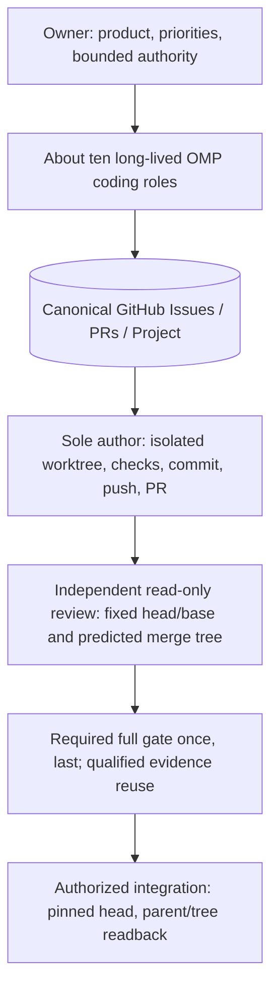

# One Engineer, an Agent Team: How I Ship a Production Product with AI Agents

Independent review caught a privacy problem in a chart-calculation-range fix before merge. In a separate October 2026 billing case, a browser agent's test-mode refund E2E showed that refunded reports continued generating; an author added regression coverage and fixed the behavior, a separate reviewer checked it, and the fix reached production. These are distinct examples of the process, not interchangeable evidence. The billing case predates standing release authority: its original Owner approvals are history, not today's deployment rule.

**Reference code:** [agentic-delivery-kit](https://github.com/mg-mg-mg/agentic-delivery-kit) contains a historical/synthetic dispatcher reference and reusable lease, guards, governance checks and navigation evaluation mechanisms. It is not the current native OMP workflow or a demonstrated OMP adapter; synthetic tests do not establish live sandbox containment.

**Visual version:** https://mg-mg-mg.github.io/agentic-engineering/

*Mingyun Chae · October 2026. Case study of the delivery process behind [TriAstra](https://triastra.ai) and a client engagement. Product source code is private. Role and reliability update: 2026-10-18; the broader process description was checked against maintained main-branch rules on 2026-10-15. Measurements carry their own dates, not a claim of current rates.*

## TL;DR

AI agents carry implementation, independent review, risk-selected verification and bookkeeping. I own product direction, priorities and the boundaries of standing authority, rather than every engineering decision.

| Impact | Historical evidence |
| --- | --- |
| A product built and run by one person | Seven languages on the web and as a ChatGPT app; roughly 1,700 registered users reported as of 2026-10-07 (not active or paying users) |
| Bugs resolved in hours | Reported median of roughly two hours from report to fix across 24 bugs, 2026-09-07 through 2026-10-08 |
| Independent review changes outcomes | Roughly one in five reviewed PRs reportedly sent back before merge as of 2026-10-08; no merged PR titled "Revert" among 249 PRs merged during 2026-09-11 through 2026-10-08 (UTC dates) |
| A client received working software | A manual workflow became a working server and role-based interfaces, with scheduling, access controls and a pre-merge E2E smoke gate |

**Measurement limits:** User, bug-time and review-return figures are approximate historical reports from private operations, not publicly verifiable measurements. Their original counting rules are unavailable; the bug-time endpoints and review-return inclusion rules are not established, so these are not precise benchmarks. The count from the private product repository's GitHub search includes all authors and dependency bots: with repository access, search with `is:pr is:merged merged:2026-09-11..2026-10-08` via `gh api search/issues` and read `total_count` (249); adding `in:title Revert` returns 0. Only someone with repository access can rerun this count. Dates are inclusive UTC calendar days. This title search does not prove that no changes were reverted or that no regressions occurred.

Supporting activity context, not a success measure: 34–45 PRs merged per day during 2026-10-03 through 2026-10-06 (UTC days; the same all-author GitHub merged-date definition). These historical observations do not measure the effect of the newer workflow.

## 1. Owner attention is the scarcest resource

The repository contract makes decision rights explicit: an agent should decide ordinary engineering questions, act, and report its reasons. Architecture-level choices are delegated; my involvement is discretionary, not a mandatory gate.

| Decision | Authority |
| --- | --- |
| Technical design, root-cause scope, refactoring, slicing, test strategy and task order | Agent decides and reports why |
| Tooling recovery, Issues, branches, worktrees, PRs, documentation and rule updates | Agent acts within scope, then records |
| Reviewed, verified code merge and criteria-based Issue/Project reconciliation | Standing authority within the original task scope; local-only, PR-only or review-only limits remain binding |
| Ordinary production release of an exact reviewed main-branch commit | RELEASE releases only on defined release triggers, never per merge, under bounded standing approval, with readiness, full-gate evidence and post-release readback; no per-commit Owner prompt |
| Money, live payment operations, stores, external sends, production data/Ops actions, accounts, credentials and boundary-crossing releases | Explicit applicable Owner approval; code merge does not grant it |
| Product direction, pricing, legal or user-facing policy facts, scope expansion | Owner decides once; agents continue independent authorized work |
| Wording in all seven locales, including Korean | AI-managed, independent exact-text-hash review; not an Owner copy-review gate |

## 2. The current native system

### About ten long-lived coding roles

The current arrangement has approximately ten long-lived role sessions: **LEADER, RELEASE, DISCOVERY, PLATFORM, BILLING, REFACTOR, BUG-FIX, FEATURE, GROWTH and OPENSOURCE**. These divide coordination, release readiness, discovery, platform and billing ownership, maintenance, product delivery, growth and upstream work. They are ownership boundaries, not ten mandatory stages or a fixed concurrency target. LEADER coordinates queue and integration conflicts; RELEASE owns exact-commit readiness and releases within applicable authority. External effects still require their applicable approval.

These are long-lived ownership roles, not evidence that all sessions are currently running. Roots delegate bounded slices within live host limits and measured memory/disk headroom, read fresh before each heavy start and sized per workload class, not a fixed global cap or worker count. One writer owns each branch and generated surface. Authors own checks, commits, push and PR preparation. Authoring roots may integrate their own independently reviewed PRs; LEADER may integrate any authorized PR and resolves cross-root conflicts. RELEASE may also integrate release-path PRs from any author and notifies LEADER.

### Actual progress, not another scheduler

Before sorting or admission, each candidate gets a compact evidence-backed product judgment in its existing Issue or PR: user harm and trust, core user value, the current journey bottleneck, affected scope with observed versus inferred evidence, and end-to-end completion cost and recurring value. The goal is observed useful user outcomes and recurring operational value, not PR or worker counts; a PR's age or sunk effort is not value.

The native LEADER finishes actionable existing PR work before ordinary new implementation, then admits eligible independent Issues from the canonical queue. Admission follows actual assigned-task progress, dependencies, writer custody and effective host capacity. Working, waiting, idle and unknown are different states; silence does not terminate a writer or transfer a branch. A blocked item gets a concrete resumption condition while other authorized work continues. There is no extra dispatcher, queue ledger or timer scheduler.

An **observation-only hold** means implementation has landed but an outcome still needs measurement. Keep the Issue open, record the observation window and due check, and admit that check rather than redispatching implementation. Landed code, released code and an observed outcome are distinct states.

### Browser work and messages

A browser teammate handles authorized test-mode E2E flows, locale/UX audits and read-only operational dashboards. Browser communication uses a file mailbox and notification relay. Coding sessions use direct addressed delivery between sessions, with recipient liveness checks and no browser relay. Messages use short Request / Result / Next / Action required sections and carry no authority; pure FYI belongs on the owning Issue or PR, not in the mailbox. Durable decisions and evidence belong there too. The two transports are different mechanisms, not evidence of an identical end-to-end benchmark.

### How it evolved — October 2026

Earlier work ran in the Codex CLI and Claude Code, then OMP and jcode; today OMP is the only coding host, routing OpenAI and Anthropic models by role. A timer-driven unattended pool with a privileged dispatcher was retired in favor of native queue ownership. Its separate verifier replay and per-deploy approval model are historical, not today's blueprint.

## 3. Gates that make speed safe

1. **Plan minimum proof by changed risk and consumers.** Run targeted regressions and actual changed-path smoke, then adversarial self-review and any needed rebase.
2. **Review a fixed pair independently.** A distinct read-only session reviews exact head/base commits and the predicted merge tree, including integration interactions and newly tracked files. The author alone changes the branch. A changed head needs fresh independent review. A changed base keeps the verdict only when the reviewer's transitive invalidation set is untouched, there are no conflicts, and relevant inputs remain equivalent; record the exact live-base/tree certificate. Otherwise the base move needs independent delta review. P1/P2 findings need a plausible reachable consumer or caller path; a reviewer-proven false PASS against a gate's promised contract blocks merge even if today's inputs do not trigger it.
3. **Run the required full gate once, last.** Resolve findings before the broad gate on the final reviewed head. Do not add a verifier merely to repeat the author's or reviewer's suite. Required independently observed changed-path proof still matters.
4. **Reuse evidence only with proof.** Inspect complete original logs and prove relevant source, dependencies, toolchain, flags, fixtures and operational inputs equivalent. Keep the original tested commit visible; disclose warm-binary reuse. Changed inputs, new interactions or uncertainty require affected checks to run again. Failed, missing or interrupted evidence blocks admission.
5. **Integrate and release separately.** Outside the lock, freeze the reviewed head, admitted base, predicted merge tree and any extension certificate in a plan; reject duplicate database-migration versions across the reviewed head and live main. Inside a short fail-closed main lease, execute one head-pinned squash. A merge counts only when its single parent equals the admitted base, its tree equals the prediction and the branch ref reads back as the squash commit. Ambiguous attempts retain the lock for reconciliation, not retries. Production releases use a separate lock and pinned checkout with their own exact-commit gate evidence and postcheck. Native tool locks and per-workload headroom replace retired Cargo-slot caps.
6. **Catch errors before runtime.** Typed contracts, generated-client freshness, owning tests and actual-surface visual proof cover the relevant risks. Test inventory must name which gate executes each test and any explicit exclusions; a test count alone proves little.
7. **AI-managed locale quality, including Korean.** Start from locale-neutral meaning, author each locale independently, and require an independent exact-text-hash `PASS + LLM_CRITIQUED` verdict. Sensitive copy also needs domain review; pricing, legal and policy facts retain their decision owners.

Every handoff distinguishes checks actually run, qualified reused evidence and remaining gaps. No unmeasured speedup is implied by avoiding duplicate work.
### What broke at ~100 concurrent agents, and what we automated

**Scale context, not a throughput benchmark:** approximately **1,450 OMP coding-agent sessions** and **3,430 sub-agent runs** since 2026-09-23; sampled peak **116 concurrent OMP coding agents** on 2026-10-15 and a seven-day average of approximately **54**, reported in the 2026-10-18 snapshot. These are **OMP coding-agent sessions only** and exclude the Aside browser agent, whose data is unavailable. Local-log estimates use five-minute samples of first-event-to-last-write intervals: overlapping intervals do not establish active execution, CPU saturation or useful output. The original seven-day averaging endpoints are not established. This update uses the supplied approximate log summary, not a fresh raw-log recount.

These failures were found during operation at that scale; concurrency is context, not proof that it caused every incident:

| What broke or needed proof | What changed |
| --- | --- |
| A release-path change merged without required admission evidence | Recorded the missing evidence honestly, without backdating, then completed it afterwards. The merge tool now refuses release-critical PRs lacking a consistent admission line. Classification combines an explicit list with the release entrypoints' transitive callee closure, rather than relying on filenames alone. |
| Independent review reproduced races where cleanup could delete a replaced file | Fixed before merge: atomic quarantine rename followed by identity/content verification, rather than assuming that an earlier path check still identified the same file. |
| A release build needed a defensible memory budget | Budgeted 32 GB; one production build measured a sampled peak of 14.7 GB RSS with zero swap. Sampling can miss short peaks; this is one workload observation, not a whole-system maximum or a guarantee for future builds. |
| A Git hook's inherited `GIT_*` environment made a test fixture flip `core.bare` in my own system | Fixed environment isolation locally and proposed the same bug-class fix upstream in [Flutter #194429](https://github.com/flutter/flutter/pull/194429), open as of 2026-10-18. Local remediation is not evidence of upstream acceptance. |

**Evidence limits:** These are private-operation accounts supplied for this case study, not independently rerunnable public incident records. No private PRs, internal identifiers or infrastructure layout are published. A preventive guardrail or pre-merge reproduction is not a measured reduction in incident rate.

**Dated activity, not an outcome metric:** counted 2026-10-18 using the private repository's GitHub search, all authors including bots: **782** merged PRs for `is:pr is:merged merged:2026-10-11..2026-10-18`; **1,051** for the last 30 inclusive UTC calendar days, `merged:2026-09-19..2026-10-18`; **1,054** for the profile's existing `merged:>=2026-09-15` definition. October 18 is a partial day. Each query includes the private repository qualifier, omitted here; `gh api search/issues` returned `incomplete_results: false`. Only repository members can reproduce these totals; they include bots and do not measure individual productivity or delivery quality.

## 4. Context tools are leads, not evidence

Local code-intelligence tools help find symbols, calls, imports and routes. Source-derived evaluation matters more than trusting an index: a baseline measured on **2026-10-03** against a pinned third-party code-graph tool on the private product repo reported route-to-handler recall of **8.5% (31 of 364)**, traced to an upstream multi-line-route defect. The kit's synthetic evaluator demonstrates the method; it does not reproduce this number. Confirm callers and impact in source. Pin tools, keep secrets and private data outside their read boundary, and do not confuse harness configuration with an OS sandbox.

## 5. Same principles, client context

On an existing client codebase, bounded authoring and independent review turned a manual workflow into working server-backed, role-based interfaces. Work included scheduling and booking locks, rescheduling, time-zone handling, authentication and access controls, and retiring a legacy UI. A client-specific pre-merge E2E smoke gate checked the working path; it is not the product's broader cross-language static gate. Deployment responsibility stayed split between my development environment and the client's release owner. Location, engagement duration, exact interface/PR counts and ratings are intentionally omitted.

## 6. Upstream fixes found by dogfooding

Running many concurrent agent sessions on one machine stresses the harness itself, so harness defects get the same treatment as product defects: reproduce, isolate, fix with a regression, and send upstream.

- **Shell built-ins blocking their own input producer** ([oh-my-pi #15501](https://github.com/can1357/oh-my-pi/issues/15501)). `read` and `mapfile` could block the runtime worker before a process-substitution producer ran, so `read line < <(cmd)` hung. The same hang stalled a live agent shell command on 2026-10-14. The maintainer's [#15509](https://github.com/can1357/oh-my-pi/pull/15509) landed the `read` deadlock fix and its single-worker regression, graciously crediting my original patch. My [#15504](https://github.com/can1357/oh-my-pi/pull/15504) was narrowed in review to a regular-file fast path and merged. The `mapfile`/`readarray` fix [#15647](https://github.com/can1357/oh-my-pi/pull/15647) remains open, with a single-worker regression that timed out before the fix and passes after it.
- **Configuration save reporting the wrong previous value** ([#15478](https://github.com/can1357/oh-my-pi/pull/15478), open). The proposed fix reports the persisted value a save replaces, not the session override.
- **Reported design issues:** clone-first worktrees copying gitignored secrets such as `.env` into every new worktree ([#15476](https://github.com/can1357/oh-my-pi/issues/15476)), and per-worktree build-cache clones exhausting disk under multi-agent use ([#15475](https://github.com/can1357/oh-my-pi/issues/15475)).
- **jcode:** contiguous TUI typing grouped into one undo step ([#1714](https://github.com/1jehuang/jcode/pull/1714)) and restored CI formatting ([#1739](https://github.com/1jehuang/jcode/pull/1739)), both merged.

Counted 2026-10-18: **7 merged, 5 open and 3 closed without merge** among my PRs across oh-my-pi, jcode, Flutter, OpenTelemetry Rust and ts-rs. Query: `author:mg-mg-mg is:pr is:public -user:mg-mg-mg -org:TriAstra-ai`, filtered to those five repositories. The seven merges are five in oh-my-pi and two in jcode; my oh-my-pi #15647 and #15478, [Flutter #194429](https://github.com/flutter/flutter/pull/194429), [OpenTelemetry Rust #3791](https://github.com/open-telemetry/opentelemetry-rust/pull/3791) and [ts-rs #501](https://github.com/Aleph-Alpha/ts-rs/pull/501) remain open. The maintainer's #15509 is not counted as my merged PR. [Contribution index](https://github.com/mg-mg-mg/mg-mg-mg/blob/main/CONTRIBUTIONS.md).

## Historical visual evidence

**Historical blueprint, not current metric evidence:** role routing and separate author/reviewer sessions remain useful ideas. The image's mandatory Owner architecture/Korean review and deployment approvals are obsolete; different-model routing is not a substitute for independent fixed-pair review. Its "All PRs" / 231 denominator is unreproduced and inaccurate: the defined UTC count above is 249, with no merged PR titled "Revert". The embedded image text needs regeneration from an editable source, not pixel editing.

## Publication hygiene

Before publishing, stage the intended files and run `bash scripts/check-publication.sh origin/main` (Git and Python 3 only). The pinned pull-request workflow checks staged text, incoming commit trees and messages, and requires GitHub noreply author and committer identities. It rejects non-noreply email addresses and common credential patterns in text. This limited guard does not inspect binary media, detect every secret or remove existing history; public text and images still require human review. Existing history is intentionally unchanged.

---

Contact: [GitHub profile — mg-mg-mg](https://github.com/mg-mg-mg)
