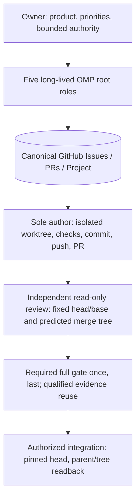
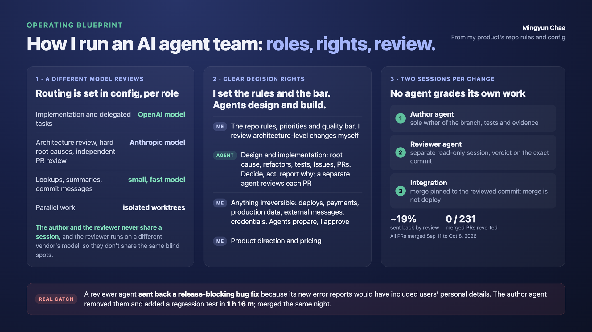

# One Engineer, an Agent Team: How I Ship a Production Product with AI Agents

Independent review caught a privacy problem in a chart-calculation-range fix before merge. In a separate October 2026 billing case, a browser agent found that refunded reports continued generating; an author fixed it, a separate reviewer checked it, and the fix reached production. These are distinct examples of the process, not interchangeable evidence.

**Reference code:** [agentic-delivery-kit](https://github.com/mg-mg-mg/agentic-delivery-kit) contains a historical/synthetic dispatcher reference and reusable lease, guards and navigation evaluation mechanisms. It is not the current native OMP workflow or a demonstrated OMP adapter; synthetic tests do not establish live sandbox containment.

**Visual version:** https://mg-mg-mg.github.io/agentic-engineering/

*Mingyun Chae · October 2026. Case study of the delivery process behind [TriAstra](https://triastra.ai) and a client engagement. Product source code is private. Current-practice description checked against maintained main-branch rules on 2026-10-13; measurements below are older snapshots, not current rates.*

## TL;DR

AI agents carry implementation, independent review, risk-selected verification and bookkeeping. I own product direction, priorities and the boundaries of standing authority, rather than every engineering decision.

| Impact | Historical evidence |
| --- | --- |
| A product built and run by one person | Seven languages on the web and as a ChatGPT app; 1,700+ registered users as of 2026-10-07 (not an active-user or paying-user count) |
| Bugs resolved in hours | Median 1.9 h from bug report to resolved fix across 24 bugs, 2026-09-07 through 2026-10-08 |
| Independent review changes outcomes | About 19% of reviewed PRs sent back before merge; 0 of 231 merged PRs reverted during 2026-09-11 through 2026-10-08. No reversions does not mean no regressions |
| A client received working software | A manual workflow became a working server and role-based interfaces, with scheduling, access controls and a pre-merge E2E smoke gate |

Supporting throughput: 34–45 independently reviewed PRs merged per day during 2026-10-03 through 2026-10-06. These historical observations do not measure the effect of the newer workflow.

## 1. Owner attention is the scarcest resource

The repository contract makes decision rights explicit: an agent should decide ordinary engineering questions, act, and report its reasons. Architecture-level choices are delegated; my involvement is discretionary, not a mandatory gate.

| Decision | Authority |
| --- | --- |
| Technical design, root-cause scope, refactoring, slicing, test strategy and task order | Agent decides and reports why |
| Tooling recovery, Issues, branches, worktrees, PRs, documentation and rule updates | Agent acts within scope, then records |
| Reviewed, verified code merge and criteria-based Issue/Project reconciliation | Standing authority within the original task scope; local-only, PR-only or review-only limits remain binding |
| Ordinary production release of an exact reviewed main-branch commit | RELEASE decides necessity under bounded standing approval, with readiness, full-gate evidence and post-release readback; no per-commit Owner prompt |
| Money, live payment operations, stores, external sends, production data/Ops actions, accounts, credentials and boundary-crossing releases | Explicit applicable Owner approval; code merge does not grant it |
| Product direction, pricing, legal or user-facing policy facts, scope expansion | Owner decides once; agents continue independent authorized work |
| Wording in all seven locales, including Korean | AI-managed, independent exact-text-hash review; not an Owner copy-review gate |

## 2. The current native system

### Five distinct root roles

- **LEADER & DELIVERY:** canonical queue admission, coordination, cross-root integration conflicts and cleanup; may integrate any authorized PR.
- **RELEASE:** exact-commit readiness, ordinary releases within standing approval, and release/store evidence within applicable authority.
- **DISCOVERY:** audits, evidence-backed Issues and specifically authorized direct fixes with independent exact-diff review.
- **OPS & GROWTH:** analytics, support preparation, content and campaign work; only exact approved external effects.
- **BILLING MIGRATION:** the migration scope, handing support and release work to their owning roots.

These are long-lived ownership roles, not evidence that all sessions are currently running. Roots delegate bounded slices within live host limits and measured heavy-work headroom, not a permanent worker-count rule. One writer owns each branch and generated surface. Authors own checks, commits, push and PR preparation. Authoring roots may integrate their own independently reviewed PRs; LEADER may integrate any authorized PR and resolves cross-root conflicts.

### Actual progress, not another scheduler

The native LEADER finishes actionable existing PR work before ordinary new implementation, then admits eligible independent Issues from the canonical queue. Admission follows actual assigned-task progress, dependencies, writer custody and effective host capacity. Working, waiting, idle and unknown are different states; silence does not terminate a writer or transfer a branch. A blocked item gets a concrete resumption condition while other authorized work continues. There is no extra dispatcher, queue ledger or timer scheduler.

An **observation-only hold** means implementation has landed but an outcome still needs measurement. Keep the Issue open, record the observation window and due check, and admit that check rather than redispatching implementation. Landed code, released code and an observed outcome are distinct states.

### Browser work and messages

A browser teammate handles authorized test-mode E2E flows, locale/UX audits and read-only operational dashboards. Browser communication uses a file mailbox and notification relay. Coding sessions use direct addressed delivery between sessions, with recipient liveness checks and no browser relay. Messages use short Request / Result / Next / Needs reply sections and carry no authority; durable decisions and evidence belong on the owning Issue or PR. The two transports are different mechanisms, not evidence of an identical end-to-end benchmark.

### How it evolved — October 2026

Earlier work used Codex and Claude Code, then OMP and jcode; the current coding host is OMP. A timer-driven unattended pool with a privileged dispatcher was retired in favor of native queue ownership. Its separate verifier replay and per-deploy approval model are historical, not today's blueprint.

## 3. Gates that make speed safe

1. **Plan minimum proof by changed risk and consumers.** Run targeted regressions and actual changed-path smoke, then adversarial self-review and any needed rebase.
2. **Review a fixed pair independently.** A distinct read-only session reviews exact head/base commits and the predicted merge tree, including integration interactions and newly tracked files. The author alone changes the branch. Changed pairs require fresh independent review or qualified delta review.
3. **Run the required full gate once, last.** Resolve findings before the broad gate on the final reviewed head. Do not add a verifier merely to repeat the author's or reviewer's suite. Required independently observed changed-path proof still matters.
4. **Reuse evidence only with proof.** Inspect complete original logs and prove relevant source, dependencies, toolchain, flags, fixtures and operational inputs equivalent. Keep the original tested commit visible; disclose warm-binary reuse. Changed inputs, new interactions or uncertainty require affected checks to run again. Failed, missing or interrupted evidence blocks admission.
5. **Integrate and release separately.** Complete admission before a fail-closed main lease; pin the reviewed head and read back the merge parent and predicted tree. Production releases use a separate lock and a pinned checkout with their own exact-commit gate evidence and postcheck. Native tool locks and measured headroom replace retired Cargo-slot caps.
6. **Catch errors before runtime.** Typed contracts, generated-client freshness, owning tests and actual-surface visual proof cover the relevant risks. Test inventory must name which gate executes each test and any explicit exclusions; a test count alone proves little.
7. **AI-managed locale quality, including Korean.** Start from locale-neutral meaning, author each locale independently, and require an independent exact-text-hash `PASS + LLM_CRITIQUED` verdict. Sensitive copy also needs domain review; pricing, legal and policy facts retain their decision owners.

Every handoff distinguishes checks actually run, qualified reused evidence and remaining gaps. No unmeasured speedup is implied by avoiding duplicate work.

## 4. Context tools are leads, not evidence

Local code-intelligence tools help find symbols, calls, imports and routes. Source-derived evaluation matters more than trusting an index: the historical navigation evaluation reported route-to-handler recall of **8.5% (31 of 364), as of 2026-10-07**, traced to a multi-line-route defect. Confirm callers and impact in source. Pin tools, keep secrets and private data outside their read boundary, and do not confuse harness configuration with an OS sandbox.

## 5. Same principles, client context

On an existing client codebase, bounded authoring and independent review turned a manual workflow into working server-backed, role-based interfaces. Work included scheduling and booking locks, rescheduling, time-zone handling, authentication and access controls, and retiring a legacy UI. A client-specific pre-merge E2E smoke gate checked the working path; it is not the product's broader cross-language static gate. Deployment responsibility stayed split between my development environment and the client's release owner. Location, engagement duration, exact interface/PR counts and ratings are intentionally omitted.

## 6. Upstream fixes found by dogfooding

Running many concurrent agent sessions on one machine stresses the harness itself, so harness defects get the same treatment as product defects: reproduce, isolate, fix with a regression, and send upstream.

- **Shell built-ins blocking their own input producer** ([oh-my-pi #15501](https://github.com/can1357/oh-my-pi/issues/15501)). `read` and `mapfile` could block the runtime worker before a process-substitution producer ran, so `read line < <(cmd)` hung. The same hang stalled a live agent shell command on 2026-10-14. Fixes: [#15504](https://github.com/can1357/oh-my-pi/pull/15504) (`read`) and [#15647](https://github.com/can1357/oh-my-pi/pull/15647) (`mapfile`/`readarray`), each with a single-worker regression that timed out before the fix and passes after it.
- **Configuration save reporting the wrong previous value** ([#15478](https://github.com/can1357/oh-my-pi/pull/15478)). A save now reports the persisted value it replaces, not the session override.
- **Reported design issues:** clone-first worktrees copying gitignored secrets such as `.env` into every new worktree ([#15476](https://github.com/can1357/oh-my-pi/issues/15476)), and per-worktree build-cache clones exhausting disk under multi-agent use ([#15475](https://github.com/can1357/oh-my-pi/issues/15475)).
- **jcode:** contiguous TUI typing grouped into one undo step ([#1714](https://github.com/1jehuang/jcode/pull/1714)) and restored CI formatting ([#1739](https://github.com/1jehuang/jcode/pull/1739)), both merged.

Status as of 2026-10-14: the oh-my-pi pull requests are open and in maintainer review; the jcode pull requests are merged. Each pull request records the reproduction, the scenario exercised and the checks run.

## Historical visual evidence

**Historical blueprint:** role routing and separate author/reviewer sessions remain useful ideas. The image's mandatory Owner architecture/Korean review and deployment approvals are obsolete; different-model routing is not a substitute for independent fixed-pair review.

---

Contact: [GitHub profile — mg-mg-mg](https://github.com/mg-mg-mg)
