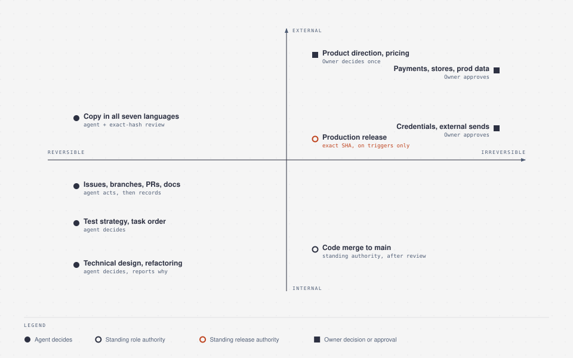
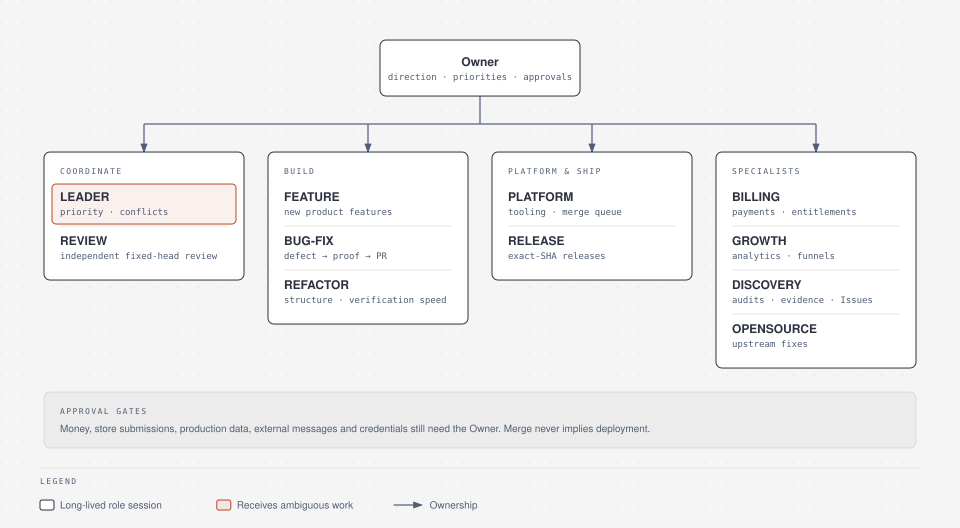
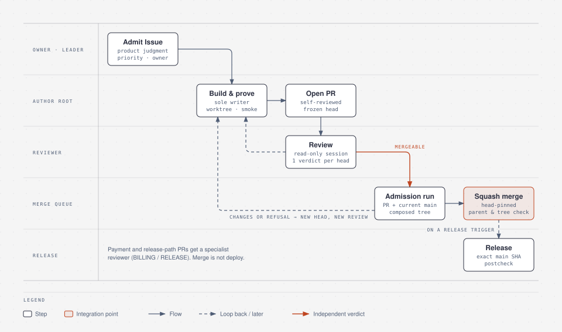
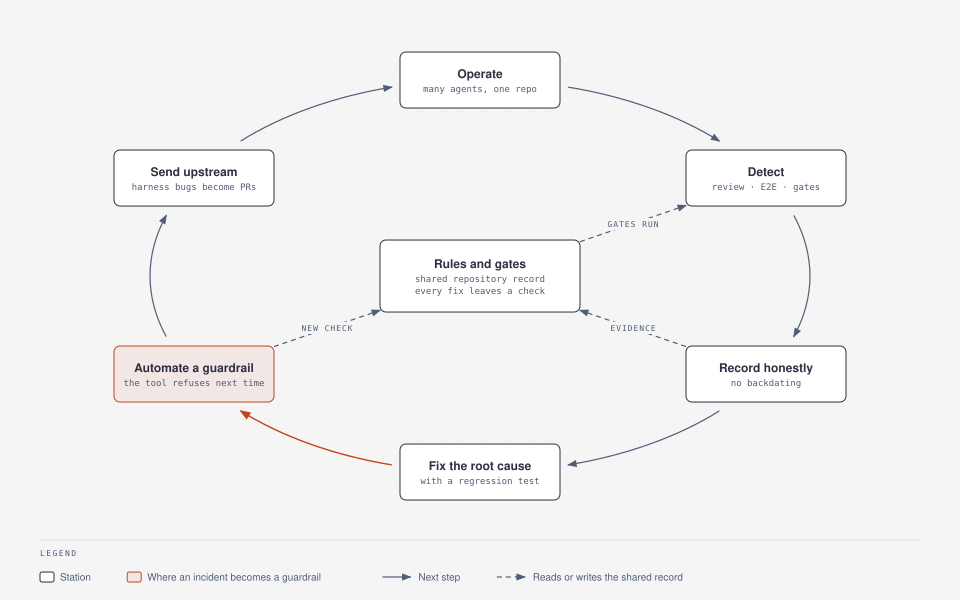

# One Engineer, an Agent Team: How I Ship a Production Product with AI Agents

I build and operate TriAstra, a seven-language AI product, and design the agent-assisted workflow behind it: scoped implementation, independent review, and verification before integration.

## At a glance

- **Product:** A seven-language AI product with Rust services, web and mobile clients, and a ChatGPT integration.
- **Delivery:** Scoped implementation, independent read-only review, risk-selected verification and controlled integration, with explicit ownership and permission boundaries.
- **Developer tooling:** Reproduced failures, upstream contributions and a public reference harness that makes selected delivery mechanisms inspectable.

**Explore:** [Current workflow](#2-current-ownership-and-execution) · [Review and billing examples](#evidence-in-practice) · [Upstream fixes](#6-upstream-fixes-found-by-dogfooding) · [Reference code](https://github.com/mg-mg-mg/agentic-delivery-kit) · [Measurement methods](#measurement-methods-and-historical-snapshots)

## Evidence in practice

Independent review caught a privacy problem in a chart-calculation-range fix before merge. In a separate October 2026 billing case, a browser agent's test-mode refund E2E showed that refunded reports continued generating; an author added regression coverage and fixed the behavior, a separate reviewer checked it, and the fix reached production. These are distinct examples of the process, not interchangeable evidence. The billing case predates standing release authority: its original Owner approvals are history, not today's deployment rule.

## 1. Owner attention is the scarcest resource

The repository contract makes decision rights explicit: an agent should decide ordinary engineering questions, act, and report its reasons. Architecture-level choices are delegated; my involvement is discretionary, not a mandatory gate.

| Decision | Authority |
| --- | --- |
| Technical design, root-cause scope, refactoring, slicing, test strategy and task order | Agent decides and reports why |
| Tooling recovery, Issues, branches, worktrees, PRs, documentation and rule updates | Agent acts within scope, then records |
| Reviewed, verified code merge and criteria-based Issue/Project reconciliation | The author prepares the qualified PR; the OPS-owned queue merges. The owning Root reconciles the outcome within the original task scope; local-only, PR-only and review-only limits remain binding |
| Ordinary production release of an exact reviewed main-branch commit | OPS releases only on defined release triggers, never per merge, under applicable standing authority, with required readiness, exact-commit evidence and post-release readback |
| Money, live payment operations, stores, external sends, production data/Ops actions, accounts, credentials and boundary-crossing releases | Explicit applicable Owner approval; code merge does not grant it |
| Product direction, pricing, legal or user-facing policy facts, scope expansion | Owner decides once; agents continue independent authorized work |
| Wording in all seven locales, including Korean | AI-managed, independent exact-text-hash review; not an Owner copy-review gate |

<picture>
  <source media="(prefers-color-scheme: dark)" srcset="assets/diagrams/decision-rights-dark.svg">
  
</picture>

Diagrams explain ownership and delivery boundaries; they are not installation, permission or measured-outcome evidence.

## 2. Current ownership and execution

### Five ownership roles, bounded workers

The current ownership model has five continuing Roots. These are responsibilities, not five serial stages, a concurrency target or proof that every session is running:

| Root | Owns |
| --- | --- |
| **LEADER** | Product priorities, admission and cross-Root scope/custody conflicts |
| **REVIEW** | Distinct fixed-head review, findings and evidence assessment |
| **ENGINEERING** | Product/domain source, defects, maintenance and dependencies within its assigned scope |
| **OPS** | Platform/infrastructure source, shared tooling, the sole merge queue and authorized exact-commit releases |
| **GROWTH** | Content/analytics source, acquisition, conversion, retention and support preparation within its assigned scope and effect permissions |

A Root owns the outcome: priorities, scope, shared contracts, writer custody, integration readiness and decision/effect boundaries. Any authoring Root can appoint a worker as the sole branch writer. Workers carry substantial bounded investigation, implementation and proof through to a usable result; they are not merely research-and-handoff roles. The Root remains accountable for integration. An independent read-only reviewer assesses frozen source rather than approving their own authoring.

Each repository Issue has one primary worker, one canonical worktree—including retries and review—one source writer and one integration owner. Reuse a suitable idle worker instead of starting duplicate campaigns. A reviewer reads the existing frozen lane; a message, age or silence does not authorize another writer or transfer custody. Workers receive only the permissions needed for their assignment; a role or task message does not independently grant deployment, payment, account or other external-effect authority.

Prioritize review findings and actionable revisions while continuing eligible disjoint work in parallel. Do not wait for every review or merge to finish before starting independent authorized work. A blocked item keeps its exact resumption condition; it does not become permission to duplicate its writer or redispatch completed implementation.

Authors own their checks, commits, push and PR preparation. The owning Root coordinates integration readiness; the **OPS-owned queue alone merges**. OPS deploys an exact main commit only under a real release trigger and applicable authority. Authoring, merging, serving a release and observing a useful user outcome are different facts.

<picture>
  <source media="(prefers-color-scheme: dark)" srcset="assets/diagrams/role-sessions-dark.svg">
  
</picture>

<picture>
  <source media="(prefers-color-scheme: dark)" srcset="assets/diagrams/change-lifecycle-dark.svg">
  
</picture>

### Durable work, maintained meaning and execution state

| Record | Authority and boundary |
| --- | --- |
| **GitHub Issues / PRs / Project** | Durable scope, priorities, ownership, decisions, evidence and remaining outcome criteria |
| **Maintained knowledge wiki** | Reusable meaning, contracts and operating policy—not a second product backlog |
| **Execution state / code controller** | Mechanical runtime transitions, leases, process lifecycle and recovery—not another product-priority ledger |

Human/AI judgment selects outcomes and resolves semantic exceptions; code should automate repetitive execution mechanics. Ordinary authorized work does not require a CPU/RAM/disk approval, an ACK receipt, or an extra manual audit ritual. Real source ownership, native tool locks, privacy, authorization, failures and explicit stop conditions still apply; a diagnostic is not a permission token.

### Controller design and installation

The code-driven controller boundary is **design / work in progress**, not a claim that a new controller or private adapter is installed or has completed real delivery runs. A source change, passing synthetic example, installation, serving behavior and measured outcome require different evidence.

The implementation direction is a Rust-first core with only necessary SDK bridges. That direction is not a claim that every component is already Rust or that a live controller migration has been qualified.

The separate [agentic-delivery-kit README](https://github.com/mg-mg-mg/agentic-delivery-kit#readme), read on 2026-10-24, describes an earlier synthetic dispatcher reference and explicitly says it has no OMP adapter. Its source is useful for studying mechanisms; it is not proof of the private workflow's installation, containment or operational results. Do not infer integration by substituting an executable name or copying the case-study diagram.

### Browser work and messages

Browser work uses an owned context for authorized UI checks and read-only operational inspection. Messages coordinate a bounded request, result or exception; they do not create effect authority or an ACK gate. Durable decisions and evidence return to the owning Issue or PR rather than becoming another mailbox ledger.

### How it evolved — October 2026

Earlier work used the Codex CLI, Claude Code, OMP and jcode. Current coding uses OMP with OpenAI Codex routing; earlier multi-vendor role routing is historical, not a definition of independent review. The timer-driven pool and privileged dispatcher were retired. Neither this history nor a reference implementation proves that the controller design above is installed.

## 3. Gates that make speed safe

1. **Select required proof by changed risk and consumers.** Run the owning behavioral checks and actual changed-path smoke. Documentation changes do not acquire every language's build merely because the repository contains it; do not add an unrelated verifier or manual hand-audit gate.
2. **Review frozen source independently.** A distinct read-only session records a fixed-head verdict or findings, with the relevant base/composition identified. The author alone changes the branch, and a changed head needs fresh independent review. Base drift calls for impact assessment and affected proof, not silently relabeling an old verdict or automatically replaying every suite. Payment and release-path risks retain their specialist review.
3. **Admit the exact composed tree through the queue.** The author submits the qualified head. The OPS-owned queue combines it with current main and selects the required risk/consumer checks, including migration-order checks when applicable. Refusals return their real cause; failed tests are not automatically rerun until they pass.
4. **Reuse evidence only with proof.** Inspect complete original logs and prove relevant source, dependencies, toolchain, flags, fixtures and operational inputs equivalent. Keep the original tested commit visible; disclose warm-binary reuse. Changed inputs, new interactions or uncertainty require affected checks to run again. Failed, missing or interrupted evidence blocks admission.
5. **Integrate and release separately.** Inside a short fail-closed main lease, the queue runner performs pinned integration and verifies the resulting parent, tree and branch ref. Ambiguous mutation is reconciled rather than blindly repeated. OPS releases an exact main commit only on a release trigger under applicable authority, with required exact-commit proof and postcheck; an author or worker does not gain self-merge or deployment rights from completing code.
6. **Catch errors before runtime.** Typed contracts, generated-client freshness, owning tests and actual-surface visual proof cover the relevant risks. Test inventory must name which gate executes each test and any explicit exclusions; a test count alone proves little.
7. **AI-managed locale quality, including Korean.** Start from locale-neutral meaning, author each locale independently, and require an independent exact-text-hash `PASS + LLM_CRITIQUED` verdict. Sensitive copy also needs domain review; pricing, legal and policy facts retain their decision owners.

Every handoff distinguishes checks actually run, qualified reused evidence and remaining gaps. No unmeasured speedup is implied by avoiding duplicate work.

### What broke at ~100 concurrent agents, and what we automated

From my local OMP session logs, five-minute samples of first-event-to-last-write intervals give approximately **1,450 OMP coding-agent sessions** and **3,430 sub-agent runs** since 2026-09-23, a peak of **~116 concurrent OMP coding agents (October 14, 22:29 UTC)** and a seven-day average of **~54** in the 2026-10-18 snapshot. These figures cover **OMP coding-agent sessions only**, excluding the Aside browser agent. Overlapping intervals do not establish active execution.

These failures were found during operation at that scale; concurrency is context, not proof that it caused every incident:

<picture>
  <source media="(prefers-color-scheme: dark)" srcset="assets/diagrams/incident-loop-dark.svg">
  
</picture>

| What broke or needed proof | What changed |
| --- | --- |
| A release-path change merged without required admission evidence | Recorded the missing evidence honestly, without backdating, then completed it afterwards. The merge tool now refuses release-critical PRs lacking a consistent admission line. Classification combines an explicit list with the release entrypoints' transitive callee closure, rather than relying on filenames alone. |
| Independent review reproduced races where cleanup could delete a replaced file | Fixed before merge: atomic quarantine rename followed by identity/content verification, rather than assuming that an earlier path check still identified the same file. |
| Historical build-sizing observation, not a current resource-approval rule | Budgeted 32 GB for that run; one production build measured a sampled peak of 14.7 GB RSS with zero swap. Sampling can miss short peaks; this is one dated workload observation, not a whole-system maximum or a requirement for future permission. |
| A test fixture most likely inherited a Git hook's `GIT_*` environment and flipped `core.bare` in the shared repository | Fixed with isolated Git environments; the same bug class is proposed upstream in [Flutter #194429](https://github.com/flutter/flutter/pull/194429), open as of 2026-10-18. |

**Evidence limits:** These are private-operation accounts, not independently rerunnable public incident records. No private PRs, internal identifiers or infrastructure layout are published. A preventive guardrail or pre-merge reproduction is not a measured reduction in incident rate.

**Dated activity, not an outcome metric:** **776 repository-wide merged PRs** in an approximately seven-day observed window, queried on **2026-10-18 at 09:52 UTC** with `is:pr is:merged merged:>=2026-10-11T10:00:00Z`. The exact start and query time define this snapshot; it is not a complete seven-calendar-day rate. Secondary context: **1,051 merged PRs** across **September 19–October 18**, 30 inclusive UTC calendar dates with October 18 partial, using `merged:2026-09-19..2026-10-18`. Both searches include all authors and bots and the private repository qualifier, omitted here; the recorded GitHub responses had `incomplete_results: false`. These dated private-operation snapshots are not independently rerunnable from this public page. Activity counts do not measure individual productivity, delivery quality or product outcomes.

## 4. Context tools are leads, not evidence

Local code-intelligence tools help find symbols, calls, imports and routes. Source-derived evaluation matters more than trusting an index: a baseline measured on **2026-10-03** against a pinned third-party code-graph tool on the private product repo reported route-to-handler recall of **8.5% (31 of 364)**, traced to an upstream multi-line-route defect. The kit's synthetic evaluator demonstrates the method; it does not reproduce this number. Confirm callers and impact in source. Pin tools, keep secrets and private data outside their read boundary, and do not confuse harness configuration with an OS sandbox.

## 5. Same principles, client context

On an existing client codebase, bounded authoring and independent review turned a manual workflow into working server-backed, role-based interfaces. Work included scheduling and booking locks, rescheduling, time-zone handling, authentication and access controls, and retiring a legacy UI. A client-specific pre-merge E2E smoke gate checked the working path; it is not the product's broader cross-language static gate. Deployment responsibility stayed split between my development environment and the client's release owner. Location, engagement duration, exact interface/PR counts and ratings are intentionally omitted.

## 6. Upstream fixes found by dogfooding

Running many concurrent agent sessions on one machine stresses the harness itself, so harness defects get the same treatment as product defects: reproduce, isolate, fix with a regression, and send upstream.

Except for the explicit **#15504 merge-state check on 2026-10-24**, the upstream statuses below are the **2026-10-18 snapshot**, not a fresh status check for this operating-model update.

- **Shell built-ins blocking their own input producer** ([oh-my-pi #15501](https://github.com/can1357/oh-my-pi/issues/15501)). `read` and `mapfile` could block the runtime worker before a process-substitution producer ran, so `read line < <(cmd)` hung. The same hang stalled a live agent shell command on 2026-10-14. The maintainer's [#15509](https://github.com/can1357/oh-my-pi/pull/15509) landed the `read` deadlock fix and its single-worker regression, graciously crediting my original patch. My [#15504](https://github.com/can1357/oh-my-pi/pull/15504), the regular-file fast path, **merged on 2026-10-15 at 12:37:09 UTC** ([primary state](https://api.github.com/repos/can1357/oh-my-pi/pulls/15504) checked 2026-10-24). This authored-PR merge is separate from the overlapping deadlock fix credited through maintainer #15509. The `mapfile`/`readarray` fix [#15647](https://github.com/can1357/oh-my-pi/pull/15647) remains open, with a single-worker regression that timed out before the fix and passes after it.
- **Configuration save reporting the wrong previous value** ([#15478](https://github.com/can1357/oh-my-pi/pull/15478), open). The proposed fix reports the persisted value a save replaces, not the session override.
- **Reported design issues:** clone-first worktrees copying gitignored secrets such as `.env` into every new worktree ([#15476](https://github.com/can1357/oh-my-pi/issues/15476)), and per-worktree build-cache clones exhausting disk under multi-agent use ([#15475](https://github.com/can1357/oh-my-pi/issues/15475)).
- **jcode:** contiguous TUI typing grouped into one undo step ([#1714](https://github.com/1jehuang/jcode/pull/1714)) and restored CI formatting ([#1739](https://github.com/1jehuang/jcode/pull/1739)), both merged.

Historical report dated 2026-10-18, **not revalidated**: **7 merged, 5 open and 3 closed without merge** among my PRs across oh-my-pi, jcode, Flutter, OpenTelemetry Rust and ts-rs. Query: `author:mg-mg-mg is:pr is:public -user:mg-mg-mg -org:TriAstra-ai`, filtered to those five repositories. The reported merge split was five in oh-my-pi and two in jcode; the reported open PRs were my oh-my-pi #15647 and #15478, [Flutter #194429](https://github.com/flutter/flutter/pull/194429), [OpenTelemetry Rust #3791](https://github.com/open-telemetry/opentelemetry-rust/pull/3791) and [ts-rs #501](https://github.com/Aleph-Alpha/ts-rs/pull/501). The original per-PR counting list is not reproduced here; this update neither revalidates nor recalculates that aggregate from a single PR's merge-state check. The maintainer's #15509 is not counted as my merged PR. [Contribution index](https://github.com/mg-mg-mg/mg-mg-mg/blob/main/CONTRIBUTIONS.md).

## Measurement methods and historical snapshots

**Reference code:** [agentic-delivery-kit](https://github.com/mg-mg-mg/agentic-delivery-kit) contains a historical/synthetic dispatcher reference and reusable lease, guards, governance checks and navigation evaluation mechanisms. It is not the current native OMP workflow or a demonstrated OMP adapter; synthetic tests do not establish live sandbox containment.

**Visual version:** https://mg-mg-mg.github.io/agentic-engineering/

*Mingyun Chae · October 2026. Case study of the delivery process behind [TriAstra](https://triastra.ai) and a client engagement. Product source code is private. Operating-model text and ownership/lifecycle diagrams updated 2026-10-24; other diagrams retain their 2026-10-21 snapshot and reliability accounts their 2026-10-18 dates. Measurements carry their own dates, not a claim of current rates.*

AI agents carry implementation, independent review, risk-selected verification and bookkeeping. I own product direction, priorities and the boundaries of standing authority, rather than every engineering decision.

| Impact | Historical evidence |
| --- | --- |
| A product built and run by one person | Seven languages on the web and as a ChatGPT app; roughly 1,700 registered users reported as of 2026-10-07 (not active or paying users) |
| Bugs resolved in hours | Reported median of roughly two hours from report to fix across 24 bugs, 2026-09-07 through 2026-10-08 |
| Independent review changes outcomes | Roughly one in five reviewed PRs reportedly sent back before merge as of 2026-10-08; no merged PR titled "Revert" among 249 PRs merged during 2026-09-11 through 2026-10-08 (UTC dates) |
| A client received working software | A manual workflow became a working server and role-based interfaces, with scheduling, access controls and a pre-merge E2E smoke gate |

**Measurement limits:** User, bug-time and review-return figures are approximate historical reports from private operations, not publicly verifiable measurements. Their original counting rules are unavailable; the bug-time endpoints and review-return inclusion rules are not established, so these are not precise benchmarks. The count from the private product repository's GitHub search includes all authors and dependency bots: with repository access, search with `is:pr is:merged merged:2026-09-11..2026-10-08` via `gh api search/issues` and read `total_count` (249); adding `in:title Revert` returns 0. Only someone with repository access can rerun this count. Dates are inclusive UTC calendar days. This title search does not prove that no changes were reverted or that no regressions occurred.

Supporting activity context, not a success measure: 34–45 PRs merged per day during 2026-10-03 through 2026-10-06 (UTC days; the same all-author GitHub merged-date definition). These historical observations do not measure the effect of the newer workflow.

## Publication hygiene

Before publishing, stage the intended files and run `bash scripts/check-publication.sh origin/main` (Git and Python 3 only). The pinned pull-request workflow checks staged text, incoming commit trees and messages, and requires GitHub noreply author and committer identities. It rejects non-noreply email addresses and common credential patterns in text. This limited guard does not inspect binary media, detect every secret or remove existing history; public text and images still require human review. Existing history is intentionally unchanged.

---

Contact: [GitHub profile — mg-mg-mg](https://github.com/mg-mg-mg)
